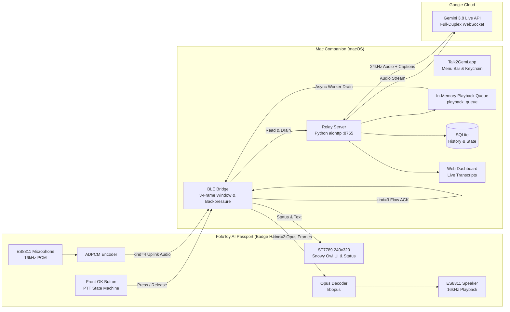

# talk2gemi

talk2gemi is an open-source firmware and macOS companion project for the **FoloToy AI Passport** (ESP32-C3 hardware badge). It connects the badge to a Mac via Bluetooth Low Energy (BLE) and relays two-way voice communication to Google's Gemini 3.8 Live API in real time, creating a dedicated Push-to-Talk (PTT) pocket badge.

---

## Overview

The goal of this project is to repurpose the FoloToy AI Passport into a practical, wearable voice assistant badge. The device does not need its own Wi-Fi connection; instead, it streams audio and control frames over BLE directly to a nearby Mac, which proxies requests to Gemini over the Mac's Internet connection.

- **Hardware Platform**: FoloToy AI Passport (ESP32-C3, ES8311 audio codec, ST7789 240×320 LCD screen, front OK button)
- **Transport Mode**: Pure BLE GATT bidirectional streaming (no device-side Wi-Fi credentials required)
- **Voice Engine**: Google Gemini 3.8 Live API (manual activity boundaries, streaming multi-turn audio and captions)
- **Downlink Audio**: 16kHz Opus VBR (~24kbps), decoded on-device and played through the onboard ES8311 codec and speaker
- **Host Support**: macOS 14+ on Apple Silicon, distributed via a standard drag-and-drop installer `Talk2Gemi.dmg` and a status bar companion app

---

## Key Features

### 1. Physical Push-To-Talk (PTT)
- Press and hold the front `[OK]` button to talk; release to send immediately.
- Adheres to Google's official Manual Activity boundaries (`activity_start` and `activity_end`), preventing voice cutoff caused by automated speech detectors.
- Audio is captured at 16kHz 16-bit mono PCM and compressed with IMA ADPCM for BLE uplink, maintaining response latency around 1.0 second.

### 2. Pure BLE GATT Transport
- All control signals, state updates, and audio packets travel over BLE GATT characteristics.
- Downlink transmission uses a 3-frame bounded sliding window and device playback queue receipts for backpressure, along with initial packet prebuffering to prevent stutter or buffer overflows.
- Includes a secure two-step pairing flow (System Code and Mac Link Code) with on-device unpair support in the settings menu.

### 3. Decoupled Long Speech Playback Queue
- The relay server implements an in-memory playback queue (`playback_queue`) and an asynchronous playback worker (`_playback_worker`).
- Cloud audio reception is fully decoupled from the physical 1:1 speaker speed, preventing WebSocket 1006 abnormal closures during continuous speeches exceeding 30 seconds.
- Verified on hardware with a complete 36.5-second recitation of Bai Juyi's poem *The Charcoal Seller* (1,168,320 PCM bytes) without truncation.

### 4. Opus Downlink Audio Codec
- Downlink audio uses `libopus` at 16kHz 20ms VBR (~24kbps), providing clear voice quality with minimal BLE channel utilization.

### 5. Snowy Owl Visual Interface
- Redesigned for the 1.54-inch ST7789 SPI display (240×320) with clean English layout and an ice-blue/cool-gray color palette.
- Features 6 distinct animated states: `Ready`, `Listening`, `Thinking`, `Speaking`, `Resting` (entered after 60 seconds of inactivity), and `Error`.
- The top status bar displays battery level, BLE status, scrolling Mac hostname, and network latency.

### 6. macOS Companion App & Installer
- Native Swift menu bar app with a black snowy owl template icon that adapts to macOS Light and Dark modes.
- Distributed as a standard `Talk2Gemi.dmg` installer package (drag-and-drop into `/Applications`) and a portable zip archive.
- Stores API keys securely in the macOS Keychain under a fixed code-signing identity to avoid repeated authorization prompts.

### 7. Local Conversation History & Web Dashboard
- Lightweight local SQLite database records speech audio, recognized transcripts, and assistant responses.
- Allows context recovery after disconnection based on local completed turns.
- Built-in web dashboard at `http://localhost:8765` provides real-time bilingual transcripts and device telemetry.

### 8. Full Flash Backup & Recovery Tooling
- Includes `scripts/backup_card.py` to extract 8MB full-flash physical images and verify partition tables.
- Bundled restoration scripts allow returning cards to factory firmware (verified with Trae and Muse factory images).

---

## Hardware Specifications

| Component | Part / Specification | Details |
| :--- | :--- | :--- |
| **SoC** | ESP32-C3-WROOM-02 (RISC-V 160MHz) | Single-core, 400KB SRAM, 8MB SPI Flash |
| **Audio Codec** | Everest ES8311 | I2S codec, drives onboard electret mic and 1W speaker |
| **Display** | ST7789V 1.54" SPI LCD | 240×320 resolution, RGB565 |
| **Buttons** | 3 physical buttons (Front OK, Side UP / DOWN) | OK button mapped to PTT; UP/DOWN handle volume and menu navigation |
| **Power Management** | Integrated Li-Po charging circuit | Type-C USB for charging, diagnostics, and firmware flashing |

---

## Architecture Diagram



---

## Quick Start

### Method 1: Using Prebuilt Packages (Recommended for Users)

1. **Install Mac Companion**:
   - Download `Talk2Gemi.dmg` from the [Releases page](releases/README.md) or `talk2gemi/dist/`.
   - Open the DMG and drag `Talk2Gemi` into your `Applications` folder.
   - Launch `Talk2Gemi`. Click the **snowy owl icon** in the menu bar and select `Gemini API Key…` to enter your Gemini API key.
2. **Turn On Badge & Pair**:
   - Power on the AI Passport flashed with talk2gemi firmware.
   - Long-press the side `DOWN` button to open `Settings` → `Connection` → `Bluetooth` → `Change Mac`.
   - Select your Mac from the scan list and confirm the two-step verification codes (System Code and Mac Link Code).
   - Once connected, the screen displays `Ready`. Press and hold the front `[OK]` button to talk.

---

### Method 2: Development & Source Compilation (For Developers)

#### 1. Prerequisites
- macOS 14+ on Apple Silicon
- Python 3.11
- ESP-IDF v5.5.3 (with `IDF_PATH` properly exported)

#### 2. Install Dependencies & Start Server
```bash
# Activate Python environment
source .venv/bin/activate
pip install -r talk2gemi/environment/requirements.lock

# Start relay server
bash talk2gemi/scripts/start_server.sh
```
*Access the web dashboard at `http://localhost:8765`.*

#### 3. Run Automated Tests
```bash
bash talk2gemi/scripts/python.sh -m unittest discover -s talk2gemi/server -p 'test_*.py'
```
*The test suite contains 43 unit tests covering audio queue buffering, voice switching, BLE ACK flow control, and keychain security.*

#### 4. Compile & Flash Firmware
```bash
# Build firmware
bash talk2gemi/scripts/build_firmware.sh

# Verify port identity and flash prebuilt binary to 0x10000 partition
python3 talk2gemi/scripts/flash_candidate.py --port /dev/cu.usbmodem1101 --write
```

---

## Backup & Recovery

Before flashing custom firmware, creating a backup of your original flash memory is recommended:

```bash
# Probe device and create an 8MB physical flash backup
python3 talk2gemi/scripts/backup_card.py --output talk2gemi/backup/my_card/
```

To restore the original factory firmware:
```bash
bash talk2gemi/backup/muse/restore_muse.sh /dev/cu.usbmodem1101
```

---

## Current Release

The current release is **v1.0 Beta** (`v1.0.0-beta`).
- **Application Firmware Image**: `firmware/talk2gemi_v1.0-beta.bin` (SHA-256: `446d99097c7c0762fb59639aa2fdc1bc817d9875eb978630585eed049cb39a75`)
- **macOS Packages**: `dist/Talk2Gemi.dmg` and `dist/talk2gemi-mac-arm64.zip`
- **Documentation & Verification**: See [CHANGELOG.en.md](CHANGELOG.en.md) and [Releases (releases/README.en.md)](releases/README.en.md).

---

## Known Limitations

1. **Requires Mac Companion**: Due to ESP32-C3 RAM limits and lack of direct Wi-Fi in the current mode, the device must stay within Bluetooth range of the host Mac, which proxies internet traffic to Gemini.
2. **Platform Support**: The companion software currently runs on macOS. Mobile apps for iOS or Android are not yet implemented.
3. **Hardware Tuning**: Firmware pinouts and audio gains are configured specifically for the FoloToy AI Passport; running on other ESP32-C3 boards may require pin remapping and component configuration.

---

## License

This project is licensed under the MIT License.
Third-party components (such as `libopus` and ESP-IDF modules) remain subject to their respective upstream licenses.
