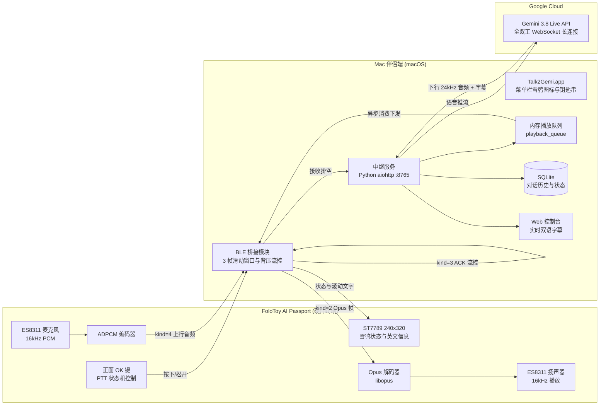

# talk2gemi

talk2gemi 是一个针对 **FoloToy AI Passport**（基于 ESP32-C3 芯片）硬件名片的开源固件与 Mac 伴侣端项目。通过蓝牙低功耗 (BLE) 将名片硬件与 Mac 伴侣程序相连，并将语音对讲实时接入 Google Gemini 3.8 Live API，实现随身携带的实体按键语音终端。

---

## 项目概述与定位

本项目旨在让闲置的 AI 名片硬件（FoloToy AI Passport）重新发挥实用价值。设备无需连接局域网 Wi-Fi，只需通过蓝牙低功耗直连随身携带的 Mac 笔记本，即可使用物理按键与大语言模型进行低延迟、高保真的双向语音交流。

- **硬件平台**：FoloToy AI Passport（ESP32-C3、ES8311 音频芯片、ST7789 240×320 液晶屏、正面 OK 按键）
- **传输模式**：纯 BLE GATT 双向流媒体通信（无需设备端配置 Wi-Fi，由 Mac 提供网络中继）
- **语音引擎**：Google Gemini 3.8 Live API（官方手动活动边界，单轮与多轮连续流式响应）
- **下行音频**：16kHz Opus VBR（约 24kbps），经由 ES8311 芯片与单声道喇叭清晰回放
- **宿主支持**：macOS 14+（Apple 芯片），提供标准拖拽安装包 `Talk2Gemi.dmg` 与任务栏雪鸮状态控制

---

## 核心功能

### 1. 实体按键语音对讲 (Push-To-Talk)
- 按下正面 `[OK]` 键开始录音，松开即刻提交。采用 Google 官方 Manual Activity 边界（`activity_start` 与 `activity_end`），避免传统 VAD 截断尾音或误判停顿。
- 上行音频采用 16kHz 16-bit 单声道采集，以 IMA ADPCM 有损压缩通过 BLE 上传，平均延迟控制在 1 秒左右。

### 2. 纯 BLE GATT 双向传输链路
- 设备与 Mac 间全部控制信号与音频流均走 BLE GATT 通道。
- 下行传输采用 3 帧有界滑动窗口与硬件播放入队回执背压机制，配合首段预缓冲，有效杜绝播放卡顿与连接断开。
- 提供配对管理与两步安全确认（System Code 与 Mac Link Code），并在设置菜单中提供清除配对功能。

### 3. 长语音流式解耦播放
- 服务端设计了内存播放队列（`playback_queue`）与异步消费协程（`_playback_worker`），将云端高速推送的 WebSocket 音频接收与硬件 1:1 实际喇叭播放完全解耦。
- 彻底解决持续 30 秒以上长语音（如诗词背诵、长篇问答）因硬件播放背压导致云端 WebSocket 超时断连的问题。实机验证白居易《卖炭翁》全诗 36.5 秒连续播报无截断。

### 4. 高保真 Opus 音频编解码
- 下行语音采用开源 `libopus` 库进行 16kHz 20ms VBR 编解码，在约 24kbps 的低码率下保持自然的语音质感，大幅降低蓝牙信道带宽压力。

### 5. 冰蓝雪鸮动态主界面
- 1.54 英寸 ST7789 彩色屏幕重新设计，采用纯英文排版与冰蓝/冷灰配色。
- 具备 6 大运行状态动态表情：`Ready`（就绪）、`Listening`（倾听）、`Thinking`（思考）、`Speaking`（回答）、`Resting`（静息，空闲 60 秒后进入）、`Error`（故障）。
- 顶部状态栏实时显示电池电量、蓝牙连接指示、Mac 电脑名称走马灯滚动及传输延迟。

### 6. macOS 伴侣应用与安装包
- 原生 Swift 编写的菜单栏伴侣应用，状态栏展示黑色雪鸮模板图标，自动适配系统浅色与深色外观。
- 提供标准 `Talk2Gemi.dmg` 安装包，拖入 `/Applications` 即可使用，无需终端命令行配置。
- API Key 安全存储于 macOS 系统钥匙串（Keychain）中，具备固定本地代码签名，避免重复授权弹窗。

### 7. 本地会话记录与 Web 监控台
- 本地轻量 SQLite 数据库持久化存储每轮对话的语音、识别文本与云端回复，支持断线后基于文字历史自动重建上下文。
- 内置 Web 监控页面（`http://localhost:8765`），提供实时双语对话字幕流与设备状态监控。

### 8. 固件备份与救砖机制
- 提供 `scripts/backup_card.py` 自动化备份工具，可拉取 8MB 完整 Flash 物理镜像并自动提取各分区。
- 归档内附一键恢复原厂固件脚本，已验证支持原厂 Trae 与 Muse 两种出厂固件。

---

## 硬件规格

| 组件 | 型号 / 规格 | 说明 |
| :--- | :--- | :--- |
| **主控芯片** | ESP32-C3-WROOM-02 (RISC-V 160MHz) | 单核，内置 400KB SRAM，外置 8MB SPI Flash |
| **音频芯片** | Everest ES8311 | I2S 音频编解码，驱动板载驻极体麦克风与 1W 扬声器 |
| **显示屏幕** | ST7789V 1.54 寸 SPI 彩屏 | 分辨率 240×320，RGB565 格式 |
| **物理按键** | 3 个（正面 OK，侧面 UP / DOWN） | OK 键用作 PTT，UP/DOWN 调整音量与菜单控制 |
| **供电管理** | 板载锂电池充电管理电路 | Type-C 接口供电、充电、日志查看与固件刷写 |

---

## 系统架构



---

## 快速使用

### 方式一：使用预编译安装包（适合普通用户）

1. **安装 Mac 伴侣端**：
   - 从 [Releases 页面](releases/README.md) 或 `talk2gemi/dist/` 下载 `Talk2Gemi.dmg`。
   - 双击打开 DMG，将 `Talk2Gemi` 拖入 `Applications` 应用程序文件夹。
   - 打开程序后，点击 Mac 菜单栏中的**雪鸮图标**，选择 `Gemini API Key…`，输入你自己的 Google Gemini API Key。
2. **设备开机与配对**：
   - 打开已刷写 talk2gemi 固件的名片硬件。
   - 长按侧面 `DOWN` 键进入 `Settings` → `Connection` → `Bluetooth` → `Change Mac`。
   - 在卡片屏幕选择你的 Mac，核对两步配对确认码（System Code 与 Mac Link Code）。
   - 配对成功后，屏幕状态显示为 `Ready`，即可按住正面 `[OK]` 键开始对讲。

---

### 方式二：从源码开发与固件编译（适合开发者）

#### 1. 软件环境要求
- macOS 14+（Apple 芯片架构）
- Python 3.11
- ESP-IDF v5.5.3 工具链（配置好 `IDF_PATH`）

#### 2. 服务端依赖安装与启动
```bash
# 激活项目 Python 环境
source .venv/bin/activate
pip install -r talk2gemi/environment/requirements.lock

# 启动中继服务端
bash talk2gemi/scripts/start_server.sh
```
*启动后可访问控制台：`http://localhost:8765`*

#### 3. 运行自动化测试
```bash
bash talk2gemi/scripts/python.sh -m unittest discover -s talk2gemi/server -p 'test_*.py'
```
*当前测试套件包含 43 项主机单元测试，覆盖音频队列缓冲、声线热切换、BLE ACK 流控与鉴权安全。*

#### 4. 固件编译与刷写
```bash
# 编译固件
bash talk2gemi/scripts/build_firmware.sh

# 检查设备串口并烧录预编译应用镜像至 0x10000 分区
python3 talk2gemi/scripts/flash_candidate.py --port /dev/cu.usbmodem1101 --write
```

---

## 固件备份与原厂恢复

在对硬件进行任何修改前，建议完整备份当前固件：

```bash
# 自动探测设备并完整拉取 8MB Flash 固件
python3 talk2gemi/scripts/backup_card.py --output talk2gemi/backup/my_card/
```

如需恢复出厂原厂系统，可直接使用备份目录内置的脚本：
```bash
bash talk2gemi/backup/muse/restore_muse.sh /dev/cu.usbmodem1101
```

---

## 当前版本与发布

当前版本为 **v1.0 Beta** (`v1.0.0-beta`)。
- **固件应用镜像**：`firmware/talk2gemi_v1.0-beta.bin`（SHA-256：`446d99097c7c0762fb59639aa2fdc1bc817d9875eb978630585eed049cb39a75`）
- **macOS 安装包**：`dist/Talk2Gemi.dmg` 与 `dist/talk2gemi-mac-arm64.zip`
- **详细记录与校验**：参见 [更新日志 (CHANGELOG.md)](CHANGELOG.md) 与 [发布归档 (releases/README.md)](releases/README.md)。

---

## 已知限制与说明

1. **依赖 Mac 伴侣端**：由于 ESP32-C3 内存有限且目前未接入直接 Wi-Fi 传输模式，设备需在 Mac 伴侣端蓝牙信号范围内工作，并由 Mac 提供 Gemini 云端网络接入。
2. **移动端伴侣应用**：目前仅支持 macOS 平台，尚未开发 iOS 或 Android 伴侣端 App。
3. **硬件兼容性**：当前固件主要针对 FoloToy AI Passport 的电路板设计与引脚分配进行了调优，其他 ESP32-C3 开发板可能需要重新调整引脚定义及外设初始化。

---

## 开源协议

本项目采用 MIT 协议开源。
部分引用的第三方音频组件（如 `libopus` 及 ESP-IDF 组件）遵循其各自的开源许可证。
